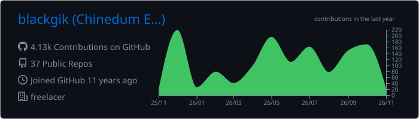
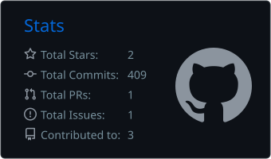
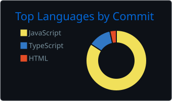

  
  
  
  

## 👋 About me

I'm a software developer who builds products end to end: the APIs and data models underneath, the web apps on top, and the servers and pipelines that ship them.

- 🏥 **Right now:** building [**Qwiva**](https://qwiva.io), an all-in-one pharmacy management platform for pharmacies in Nigeria: POS, batch and expiry tracking, purchase orders, cash reconciliation and reporting.
- 🚚 **On the side:** [**Relay**](https://github.com/blackgik/relay-systems), a peer-to-peer logistics network where travellers carry packages along routes they already take.
- 🌱 **Learning:** AWS SysOps, cloud infrastructure and system design.
- 🔭 **Interested in:** servers and cloud computing, distributed systems, blockchain, and graphics.
- 🤝 **Open to** collaborating on open-source software. Reach me on [LinkedIn](https://www.linkedin.com/in/ebchinedum).

## 🚀 Featured work

<table>
  <tr>
    <td width="50%" valign="top">
      <h3>🏥 Qwiva</h3>
      
Pharmacy management SaaS used by pharmacies across Nigeria. Point of sale with camera scanning and pack/strip/unit selling, first-expiry-first-out batches, purchase orders shared by secure link, cash register reconciliation, budgets, staff permissions, multi-branch, and fourteen question-led reports.

      

        
        
        
        
        
      

      <a href="https://qwiva.io"><b>qwiva.io →</b></a>
    </td>
    <td width="50%" valign="top">
      <h3>🚚 Relay</h3>
      
Peer-to-peer logistics: senders book spare bag space with verified carriers, payment sits in escrow until delivery is confirmed, and packages can hop across several travellers to reach their destination, with live tracking and custody handovers.

      

        
        
        
      

      <a href="https://github.com/blackgik/relay-systems"><b>blackgik/relay-systems →</b></a>
    </td>
  </tr>
</table>

## 🛠️ Tech stack

**Languages & frameworks**

**Data, infrastructure & tooling**

## 📊 GitHub stats

<!-- Cards are regenerated daily by .github/workflows/profile.yml -->

  

  
  

  

## 🐍 Contributions

<picture>
  <source media="(prefers-color-scheme: dark)" srcset="https://raw.githubusercontent.com/blackgik/blackgik/output/github-contribution-grid-snake-dark.svg" />
  <source media="(prefers-color-scheme: light)" srcset="https://raw.githubusercontent.com/blackgik/blackgik/output/github-contribution-grid-snake.svg" />
  
</picture>

**Let's build something useful together.**
 
<a href="https://www.linkedin.com/in/ebchinedum">Connect on LinkedIn</a> · <a href="https://qwiva.io">See what I'm building</a>

